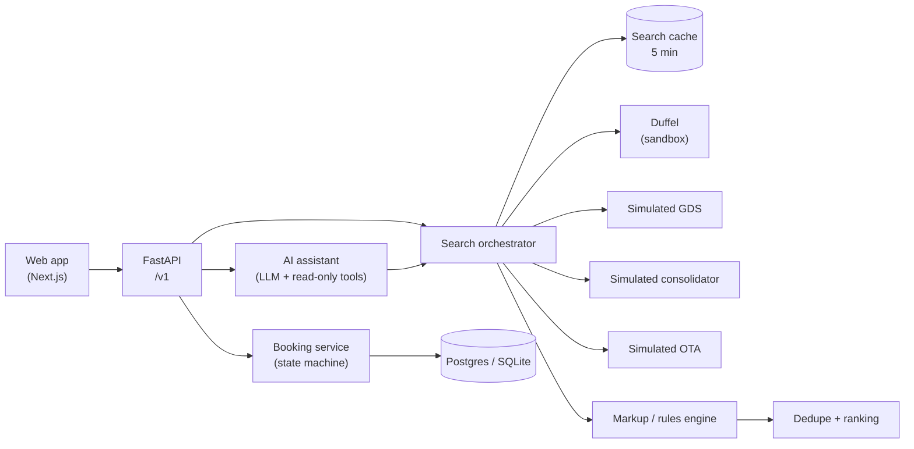

# Booking Agent

A flight search and booking platform for travel agents. An agent describes a trip in plain
language (or uses the search form); the platform searches several suppliers in parallel,
normalises every result into one offer format, prices it in INR with the agency's markup,
and shows the best-value options side by side. Booking is a separate, human-confirmed step.

**Live demo:** https://booking-agent-lemon.vercel.app (no sign-in needed)

> **Demo data only.** Fares come from three *simulated* suppliers (real airports and
> airlines, generated prices) and the **Duffel sandbox** (test airline data). No real money
> moves and no real tickets are issued. Simulated results carry a "Simulated data" badge;
> Duffel results are labelled "Duffel (sandbox)".

---

## Contents

- [Features](#features)
- [How it works](#how-it-works)
- [Tech stack](#tech-stack)
- [Project structure](#project-structure)
- [Run it locally](#run-it-locally)
- [Configuration](#configuration)
- [Suppliers](#suppliers)
- [AI assistant](#ai-assistant)
- [Booking flow](#booking-flow)
- [Access and roles](#access-and-roles)
- [API reference](#api-reference)
- [Testing](#testing)
- [Deployment](#deployment)
- [Security and compliance](#security-and-compliance)
- [Known limitations](#known-limitations)
- [Build status](#build-status)

---

## Features

**Flight search**
- One way, return and **multi-city** (up to 6 flights) journeys.
- Dates entered as DD / MM / YYYY with a calendar picker, plus a time-of-day choice per
  flight (any time, early morning, morning, afternoon, evening — airport-local time).
- Adults, children and infants (up to 9 passengers, never more infants than adults) and
  cabin class.
- Advanced options: stops per flight, preferred airlines, checked bag included, refundable
  fares only, no overnight layovers.
- Results stream in supplier by supplier, with a live status strip showing which suppliers
  answered, failed or timed out. Partial failure is shown, never hidden.
- Duplicate fares from different suppliers are merged into one card ("Also via …").
- Sort by best value, cheapest or fastest. "Best value" adjusts the price for baggage and
  refundability and is computed in code.
- Offer details: every flight and layover, baggage, change/cancel/refund rules (unknown is
  shown as "unknown", never as "no"), and a price breakdown.
- Live re-price of any offer; price changes are shown before booking.
- Search settings are kept in the page URL, so a search can be shared or reloaded.

**AI assistant** — ask in plain English ("Cheapest DEL to BOM on 20 Nov, 2 adults").
The assistant searches, compares and explains trade-offs, and shows offer cards priced by
code. It can't book: booking always goes through the confirmation form.

**Bookings** — gated booking with a live re-price and a separate confirm click, a bookings
list with filters (status, dates, free-text search, paging), and a detail page with the
status timeline.

**Dashboard** — bookings and sales this month, upcoming trips, bookings over the last 30
days, sales by supplier, recent bookings and recent searches.

**Built for agencies** — multi-tenant data model, an agency markup engine (demo agency:
4% + ₹199 per booking), and role-based views (Agents see sell prices only; Admins also see
net fares, markups and supplier performance).

---

## How it works



1. **Connectors** (one per supplier) call the supplier and map its response into a single
   `Offer` model: slices and segments, fare basis and family, baggage, fare rules, a price
   breakdown, an INR total and an expiry. Non-INR prices are converted with ECB rates and
   the original currency, rate and timestamp are kept for audit.
2. The **orchestrator** fans out to all enabled suppliers in parallel, with a per-supplier
   timeout (7 s), circuit breaker and concurrency limit, and streams events (Server-Sent
   Events) as each supplier finishes.
3. The **rules engine** applies agency markups and commissions, then offers are
   **deduplicated** across suppliers and **ranked**.
4. **Booking** always re-prices live first (cached prices are only a display hint), then
   needs an explicit confirmation tied to that exact price and passenger list.

Money is always `Decimal` with a currency code, never a float.

---

## Tech stack

| Layer | Technology |
|---|---|
| API | Python 3.12+, FastAPI, Pydantic v2, httpx, structlog, OpenTelemetry |
| Data | SQLAlchemy 2 (async) + Alembic; Postgres (Supabase in production) or SQLite locally |
| Cache | Redis, or in-process `memory://` (fakeredis) for local runs and small deployments |
| AI | Groq (`openai/gpt-oss-120b`) by default; Gemini, Cerebras or Anthropic as alternatives |
| Suppliers | Duffel API (sandbox) + three simulated suppliers |
| Web | Next.js 16 (App Router), React 19, TypeScript, Tailwind CSS 4 |
| Tests | pytest, respx, hypothesis; Playwright for the web app |
| Tooling | uv, ruff, mypy (strict) |
| Hosting | Render (API), Vercel (web), Supabase (Postgres) |

---

## Project structure

```
.
├── src/booking_agent/
│   ├── domain/          # Offer, itinerary, money, search query, booking state machine
│   ├── connectors/      # Supplier adapters (Duffel, Amadeus stub, fakes) + FX
│   ├── simulated/       # Simulated suppliers: airports, route network, pricing
│   ├── orchestrator/    # Parallel search, circuit breaker, dedupe, ranking, filters
│   ├── rules/           # Markup / commission rules engine
│   ├── agent/           # AI assistant: runner, tools, prompts, LLM adapters, post-check
│   ├── booking/         # Booking service, repository, passenger encryption, payments
│   ├── dashboard/       # Dashboard figures, recent searches, demo data seeding
│   ├── api/             # FastAPI app, routes, middleware, role-based views
│   ├── auth/            # Caller identity and roles (visitor / API key)
│   ├── cache/           # Search result cache
│   ├── db/              # SQLAlchemy models and engine (Supabase-ready)
│   ├── observability/   # Logging, secret redaction, tracing, request metrics
│   └── data/airports.csv
├── alembic/             # Database migrations
├── web/                 # Next.js web app (pages in src/app, tests in tests/)
├── tests/
│   ├── unit/            # Unit and API tests
│   ├── integration/     # Booking repository contract tests (memory, SQLite, Postgres)
│   ├── agent_evals/     # 32 scripted AI-assistant scenarios
│   ├── load/            # Concurrent search load test
│   └── fixtures/        # Recorded, redacted supplier responses
├── scripts/             # build_airports.py, record_fixture.py
├── docs/                # compliance.md, dashboards.yaml (Grafana panels)
├── render.yaml          # Render blueprint for the API
└── docker-compose.yml   # Optional local Postgres + Redis
```

---

## Run it locally

### Prerequisites

- Python 3.12 or newer and [uv](https://docs.astral.sh/uv/)
- Node.js 20 or newer
- Optional: Docker (only for a local Postgres/Redis; SQLite and in-memory Redis need nothing)

### 1. Install

```bash
uv sync --group dev
```

```bash
npm --prefix web install
```

### 2. Configure

```bash
cp .env.example .env
```

Then edit `.env`. For a local run you need at least:

| Variable | Value |
|---|---|
| `REDIS_URL` | `memory://` (no Redis server needed) |
| `DATABASE_URL` | `sqlite+aiosqlite:///./data/booking_agent.db` (already the default) |
| `BOOKING_ENCRYPTION_KEY` | a key from the command below |
| `GROQ_API_KEY` | a free key from https://console.groq.com, for the assistant |
| `DUFFEL_ACCESS_TOKEN` | optional: a `duffel_test_…` token from https://app.duffel.com |

Generate the encryption key (keep it: changing it makes stored passenger details unreadable):

```bash
uv run python -c "from cryptography.fernet import Fernet; print(Fernet.generate_key().decode())"
```

`.env` is git-ignored. Never commit it.

### 3. Start the API (http://localhost:8000)

```bash
uv run alembic upgrade head
```

```bash
uv run uvicorn booking_agent.api.main:app --reload --port 8000
```

Check it: http://localhost:8000/ready lists the database, the cache and each supplier's
status. Interactive API docs: http://localhost:8000/docs

### 4. Start the web app (http://localhost:3000)

```bash
npm --prefix web run dev
```

Open http://localhost:3000. There is no sign-in; the app opens on the dashboard. With
`DEMO_MODE=true`, 30 demo bookings are seeded into an empty database.

---

## Configuration

All settings are environment variables (see `.env.example`).

| Variable | Default | Purpose |
|---|---|---|
| `DATABASE_URL` | *(empty = in memory)* | SQLite, local Postgres, or a Supabase pooler URL (`postgresql://…` is accepted as given) |
| `BOOKING_ENCRYPTION_KEY` | — | Fernet key for passenger data at rest; required when `DATABASE_URL` is set |
| `REDIS_URL` | `redis://localhost:6379/0` | Search cache; `memory://` for an in-process cache |
| `SUPPLIERS_ENABLED` | `all` | Comma list of `duffel`, `sim_gds`, `sim_consolidator`, `sim_ota`, or `all` |
| `DUFFEL_ACCESS_TOKEN` | — | Duffel **test** token; anything not starting with `duffel_test_` is refused |
| `DUFFEL_SUPPLIER_TIMEOUT_MS` | `5000` | Duffel request timeout |
| `BOOKING_LIVE_ENABLED` | `false` | Must be `true` for Duffel sandbox bookings |
| `SIM_LATENCY_MIN_S` / `SIM_LATENCY_MAX_S` | `0.2` / `1.5` | Simulated supplier response time |
| `SIM_FAILURE_RATE` | `0.08` | Chance a simulated supplier search fails (shows partial failure) |
| `SIM_PRICE_CHANGE_RATE` | `0.05` | Chance a simulated re-price comes back higher |
| `GROQ_API_KEY`, `GROQ_MODEL` | —, `openai/gpt-oss-120b` | Assistant LLM (first configured provider wins: Groq → Cerebras → Gemini → Anthropic) |
| `GEMINI_API_KEY`, `GEMINI_MODEL` | —, `gemini-flash-latest` | Alternative LLM |
| `CEREBRAS_API_KEY`, `CEREBRAS_MODEL` | — | Alternative LLM |
| `ANTHROPIC_API_KEY`, `ANTHROPIC_MODEL` | — | Alternative LLM (both must be set) |
| `LLM_REASONING_EFFORT` | `low` | For gpt-oss models |
| `LLM_TIMEOUT_S` / `AGENT_TURN_TIMEOUT_S` / `AGENT_MAX_TOOL_ROUNDS` | `20` / `45` / `3` | Assistant limits |
| `DEMO_MODE` | `false` | Demo agency markup and seeded demo bookings |
| `API_KEY`, `API_KEY_TENANT` | —, `demo-agency` | Optional key for scripts; callers sending it in `X-API-Key` act as Admin |
| `CORS_ORIGINS` | `http://localhost:3000` + the Vercel site | Allowed browser origins (comma list) |
| `RATE_LIMIT_MAX_REQUESTS` / `RATE_LIMIT_WINDOW_SECONDS` | `300` / `60` | Per-IP rate limit |
| `LOG_LEVEL` | `INFO` | Logging level |

Web app (build-time):

| Variable | Purpose |
|---|---|
| `API_PROXY_URL` | Deployed: the API's URL. The web app forwards `/v1/*` there, so the browser only talks to the web app's own domain |
| `NEXT_PUBLIC_API_URL` | Optional override of the API base URL. Leave unset in production |

---

## Suppliers

| Supplier | Kind | Notes |
|---|---|---|
| `duffel` | Real API, **sandbox** | Offer requests and instant orders against Duffel's test environment. Live tokens are refused at startup. Results labelled "Duffel (sandbox)" |
| `sim_gds` | Simulated | Published fares, every fare family, sells ~90% of flights, ₹150 (domestic) / ₹300 (international) service fee per passenger, fare rules almost always disclosed |
| `sim_consolidator` | Simulated | Negotiated net fares ~3.5% below published, no fees, fewer fare families, sells ~75% of flights, often doesn't disclose baggage/refund rules |
| `sim_ota` | Simulated | Published fares plus a 6% OTA markup, no basic "Lite" fares, sells ~85% of flights |

The simulated suppliers use 110 real airports (from OurAirports, public domain) with their
time zones, real regional airlines and real hub connections, with non-stop and one-stop
itineraries and layovers of 1–6 hours. Results are deterministic for the same route, date
and supplier; latency and occasional outages are random, to exercise partial-failure
handling. Amadeus self-service was shut down in July 2026; its adapter is kept but disabled.

---

## AI assistant

The assistant (page **Assistant**, endpoint `POST /v1/agent/chat/stream`) turns a request
into a search, compares options and explains trade-offs. Its tools are read-only:
`search_flights`, `get_offer_details`, `compare_offers`, `explain_ranking`.

Guarantees:
- **Prices come from code.** Offer cards are priced by the backend; the model's reply is
  checked against tool results, and invented prices are rejected.
- **It never books or pays.** Booking is a separate form in the web app.
- **Passenger details never reach the model.** They're entered only in the booking form.
- Bounded cost and time: 20 s per model call (one retry), 45 s per turn, at most 3 tool
  rounds, and only the top 5 offers are sent to the model.
- `GET /v1/agent/health` pings the configured model and reports latency and rate limits.

---

## Booking flow

1. **Book** on an offer opens the booking form (one row per passenger, typed as adult,
   child or infant to match the fare).
2. **Get live price** calls `POST /v1/bookings/prepare`: the offer is re-priced with the
   supplier, passenger types and ages are checked against the fare, and a confirmation
   token tied to that exact price and passenger list is returned (valid for a few minutes).
3. **Confirm and book** calls `POST /v1/bookings/{id}/confirm` with the token.

Bookings move through a strict state machine — draft, priced, confirmed by user, PNR
created, payment pending, paid, ticketed, failed, cancelled, expired — and illegal
transitions are rejected. Every book/pay call uses an idempotency key and is never
retried automatically. Payment uses a fake gateway (simulated) or Duffel Balance (sandbox).

---

## Access and roles

There is **no sign-in**. Every request without credentials is the built-in **visitor**, an
**Agent** of the demo agency:

| Role | Who | Sees |
|---|---|---|
| Agent | Every web visitor | Sell prices only — never net fares, markups or supplier performance |
| Admin | Scripts sending `X-API-Key` (only when `API_KEY` is set) | Also net fares, markups, price breakdowns, supplier performance, markup rules and hotel search |

A wrong API key is rejected (401). Requests are rate limited per client IP. Tests walk every
response a visitor can receive and fail if any net-fare or markup field appears.

Because there's no login, anyone with the site's URL can search, use the assistant (which
uses the configured LLM quota) and make demo bookings.

---

## API reference

Interactive docs at `/docs` on a running API. All business endpoints are under `/v1`.

| Method | Path | Description |
|---|---|---|
| GET | `/health` | Liveness |
| GET | `/ready` | Readiness: cache, database and per-supplier status |
| POST | `/v1/search` | Start a search (one way, return or multi-city legs) |
| GET | `/v1/search/{search_id}/stream` | Results as Server-Sent Events |
| GET | `/v1/search/{search_id}` | Snapshot of a search |
| GET | `/v1/airports?q=` | Airport autocomplete (code, city or name) |
| POST | `/v1/offers/{offer_id}/price` | Live re-price of an offer |
| POST | `/v1/agent/chat` | Assistant (single response) |
| POST | `/v1/agent/chat/stream` | Assistant (streaming) |
| GET | `/v1/agent/health` | LLM connectivity check |
| POST | `/v1/bookings/prepare` | Re-price and create a priced booking; returns a confirmation token |
| POST | `/v1/bookings/{booking_id}/confirm` | Confirm with the token and book |
| POST | `/v1/bookings/{booking_id}/cancel` | Cancel a booking |
| GET | `/v1/bookings` | List bookings (`status`, `from`, `to`, `q`, `page`, `page_size`) |
| GET | `/v1/bookings/{booking_id}` | Booking detail |
| GET | `/v1/dashboard/summary` | Dashboard figures |
| GET | `/v1/dashboard/charts` | Dashboard charts |
| GET, POST | `/v1/admin/rules` | List / create markup rules (Admin) |
| GET, PUT, DELETE | `/v1/admin/rules/{rule_id}` | Read / update / delete a rule (Admin) |
| POST | `/v1/hotels/search` | Hotel search (Admin, prototype) |
| GET | `/v1/hotels/search/{search_id}` and `/stream` | Hotel results (Admin) |

Example search:

```bash
curl -X POST http://localhost:8000/v1/search -H "Content-Type: application/json" -d '{"journey_type":"return","legs":[{"origin":"DEL","destination":"BOM","departure_date":"2026-12-10","time_window":"morning"},{"origin":"BOM","destination":"DEL","departure_date":"2026-12-15"}],"pax_counts":{"adults":2,"children":0,"infants":0},"cabin":"ECONOMY"}'
```

---

## Testing

| Suite | Command | What it covers |
|---|---|---|
| Backend | `uv run pytest` | ~770 unit, API and integration tests, plus 32 assistant eval scenarios with a scripted model |
| Lint | `uv run ruff check src tests` | Style and imports |
| Types | `uv run mypy src` | Strict type checking |
| Web | `npm --prefix web test` | Playwright: search form, results, assistant, bookings, dashboard (API mocked) |
| Web lint | `npm --prefix web run lint` | ESLint |
| Load | `uv run python -m tests.load.load_test` | 100 concurrent searches; latency percentiles and throughput |

The Postgres repository tests run when a local Postgres is up (`docker compose up -d
postgres`) and are skipped otherwise. A `Makefile` wraps the backend commands
(`make test`, `make lint`, `make typecheck`, `make run`).

---

## Deployment

Production runs as three services:

| Part | Host | Configuration |
|---|---|---|
| API | Render | `render.yaml` (Blueprint) |
| Web app | Vercel | Project root `web`; env `API_PROXY_URL` |
| Database | Supabase | Postgres via the Session pooler |

### Database (Supabase)

1. Create a Supabase project.
2. In **Connect → Session pooler**, copy the URI (it ends in
   `pooler.supabase.com:5432/postgres`) and put your database password in it.
   Use the pooler, not the direct connection: the direct host is IPv6-only.

### API (Render)

1. In Render: **New → Blueprint**, pick this repository. `render.yaml` defines the service.
2. Fill in the values Render asks for: `DATABASE_URL` (the Supabase URI),
   `BOOKING_ENCRYPTION_KEY`, `DUFFEL_ACCESS_TOKEN`, `GROQ_API_KEY`, `GEMINI_API_KEY`.
3. On every start Render runs `alembic upgrade head`, then the server. Demo bookings are
   seeded only into an empty database. Pushes to `main` redeploy automatically.
4. Check `https://<your-service>.onrender.com/ready` — `"db": true` means Supabase is
   connected.

### Web app (Vercel)

1. Import the repository and set **Root Directory** to `web`.
2. Add `API_PROXY_URL` = your Render URL (no trailing slash). Don't set
   `NEXT_PUBLIC_API_URL`.
3. Deploy. The web app forwards `/v1/*` to Render, so the browser only talks to Vercel.

Render's free plan sleeps after about 15 minutes idle; the first request after that can
take up to a minute.

---

## Security and compliance

- Secrets live only in environment variables, never in code. Logs redact supplier tokens,
  bearer credentials, API keys, configured secret values and database passwords.
- Passenger details are encrypted at rest (Fernet) and never logged or sent to the LLM.
- Net fares are visible only to Admins of the owning tenant and are never logged.
- Duffel runs in test mode only; live tokens are refused.
- Supplier fixtures in `tests/fixtures` are recorded responses with tokens and personal
  data removed (`scripts/record_fixture.py` does the redaction).
- See [`docs/compliance.md`](docs/compliance.md) for PCI-DSS, DPDP/GDPR and data-retention
  notes, and [`docs/dashboards.yaml`](docs/dashboards.yaml) for the monitoring panels.

---

## Known limitations

- **Demo data only:** simulated suppliers and the Duffel sandbox; no real fares or tickets.
- **No sign-in:** the public site is open to anyone; Admin features need an API key.
- **Single instance:** searches in progress and assistant sessions are kept in the API's
  memory, so the API should run as one instance.
- **Free hosting:** the API sleeps when idle; the first request after a pause is slow.
- **Hotels** are an Admin-only prototype with a fake supplier.

---

## Build status

| Step | Area | Status |
|---|---|---|
| 0–1 | Project setup, offer schema | Done |
| 2 | Connector interface and fakes | Done |
| 3 | Amadeus adapter | Built; disabled (self-service shut down) |
| 4 | Dedupe and ranking | Done |
| 5 | Search orchestrator | Done |
| 6 | Cache and HTTP API | Done |
| 7 | Comparison UI | Done |
| 8 | B2B adapters | Duffel (sandbox) + simulated suppliers |
| 9 | Markup / rules engine | Done |
| 10 | Read-only AI assistant and evals | Done |
| 11 | Gated booking and ticketing | Done (sandbox and simulated) |
| 12 | Observability, security, compliance | Done |
| 13 | Hotels | Prototype (Admin only) |
